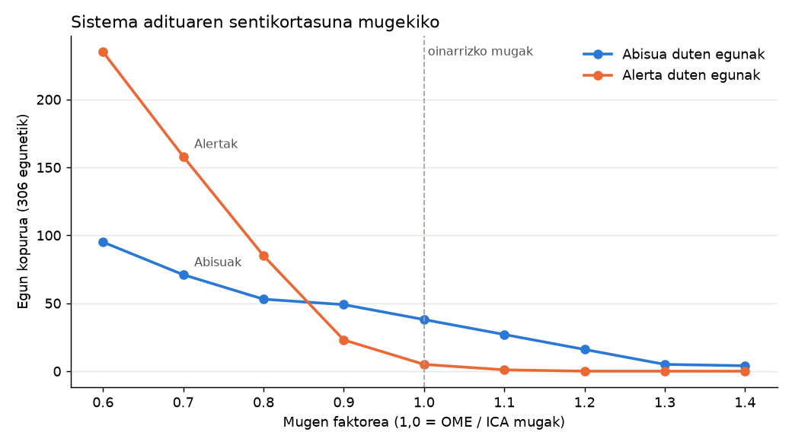

# Smart Environment AI – Adimen Artifizialaren Ereduak (MIA)

**Erronka:** 2. Erronka – Airearen Kalitatearen Monitorizazioa eta Iragarpen Adimenduna
**Modulua:** 5071. Adimen Artifizialaren ereduak · **Zikloa:** Adimen Artifiziala eta Big Data (FP San Jorge, Santurtzi)
**Taldea:** 3. taldea – ⚠ *taldekideen izenak gehitu*

> Txosten honek MIA moduluko entregagarriak biltzen ditu: sare neuronala eta haren ebaluazioa (4.), Jetson Nano-ko sistema (5.), dashboard-a (6.) eta sistema aditua (7.). Datuen analisia PIA zatian dago (`Erronka2PIA/erronka.ipynb`) eta eredu klasikoak SAA zatian (`Erronka2SAA/konparazio_txostena.md`).

## Aurkibidea

1. [Sarrera](#1-sarrera)
2. [Adimen Artifizialeko sistemen ezaugarriak](#2-adimen-artifizialeko-sistemen-ezaugarriak-ra1)
3. [Sistemaren eskakizunak](#3-sistemaren-eskakizunak-ra2-a)
4. [AA ereduen sailkapena eta egokitasuna](#4-aa-ereduen-sailkapena-eta-egokitasuna-ra2-bg)
5. [Sare neuronala eta eredu klasikoekin konparazioa](#5-sare-neuronala-eta-eredu-klasikoekin-konparazioa)
6. [Zabaltzea Jetson Nano-n](#6-zabaltzea-jetson-nano-n)
7. [Sistema aditua](#7-sistema-aditua-ra5)
8. [Dashboard-a](#8-dashboard-a)
9. [Ondorioak, mugak eta hobekuntzak](#9-ondorioak-mugak-eta-hobekuntzak)
10. [Iturriak](#10-iturriak)

---

## 1. Sarrera

NexAI Innovations-ek Bizkaiko Foru Aldundiarentzat airearen kalitatea monitorizatzeko sistema adimendun bat garatu du. Sistemak Mundakako estazioko eguneko neurketak (NO, NOX, NO2, O3, PM10 eta PM2,5; Open Data Euskadi) jasotzen ditu eta:

1. **PM10-aren kontzentrazioa kalkulatzen du** Ridge erregresioarekin (neurgailuak daturik ematen ez duenean ere).
2. **Kalitate-kategoria ematen du** (Airearen Kalitatearen Indizea, ICA).
3. **Egun-mota identifikatzen du** K-means klusterrekin (NOx altuko egunak, aire garbiko egunak, O3 eta partikula altuko egunak).
4. **Alertak sortzen ditu** sistema aditu baten bidez, eta arrisku-indize lauso bat kalkulatzen du.

Dena Jetson Nano gailuan exekutatzen da (*edge computing*), eta emaitzak denbora errealeko dashboard simulatu batean ikusten dira.

```
 Neurgailuak / CSV ──► Aurreprozesamendua ──► Ridge (PM10) ──┐
                       (mediana, estand.,     K-means ───────┤──► Sistema aditua ──► Alertak
                        one-hot)                              │    + logika lausoa
                                                              └──────────────────► Dashboard-a
                       └──────────────── Jetson Nano (NumPy) ─────────────────┘
```

## 2. Adimen Artifizialeko sistemen ezaugarriak (RA1)

### 2.1. Sistema adimendunen oinarrizko printzipioak (RA1 a)

Sistema adimendun batek ingurunea **hautematen** du (sentsoreak, datuak), informazio hori **arrazoitzen edo ikasten** du (ereduak, arauak) eta **ekintzak** hartzen ditu (iragarpenak, alertak). Ezaugarri nagusiak:

| Printzipioa | Gure sisteman |
|---|---|
| Hautematea | Estazioko kutsatzaile-neurketak (6 aldagai, egunero) |
| Ikaskuntza | Ridge eta MLP (gainbegiratua), K-means (gainbegiratu gabea) |
| Arrazoiketa | Sistema aditua (arauak) eta logika lausoa (ziurgabetasuna) |
| Ekintza | Alertak, gomendioak eta dashboard-a |
| Autonomia | Jetson Nano-n, hodeiaren beharrik gabe |
| Azalgarritasuna | Ridge-ren koefizienteak eta alerta bakoitzaren araua |

### 2.2. AA aplikatzen den arloak (RA1 b)

- **Ingurumena:** airearen kalitatearen iragarpena (Copernicus CAMS), uholdeen eta suteen detekzioa.
- **Osasuna:** irudi medikoen diagnostikoa, epidemien jarraipena.
- **Industria 4.0:** mantentze prediktiboa, kalitate-kontrola ikusmen artifizialarekin.
- **Mugikortasuna:** trafikoaren kudeaketa, ibilgailu autonomoak.
- **Energia:** sare elektrikoen eskariaren iragarpena.
- **Administrazio publikoa:** herritarrentzako zerbitzuen automatizazioa, baliabideen plangintza.

### 2.3. Oinarrizko teknikak (RA1 c)

Ikaskuntza gainbegiratua (erregresioa, sailkapena), gainbegiratu gabea (clustering-a, PCA), sare neuronalak, sistema adituak, logika lausoa, ikusmen artifiziala eta errefortzu bidezko ikaskuntza. Erronka honetan lehen bostak erabili ditugu.

### 2.4. Eraginkortasun operatiboa eta negozio-elkarrekintza berriak (RA1 d)

Aldundiarentzat sistemak honako hobekuntzak ekartzen ditu:

- **Alerta goiztiar automatikoak:** teknikari batek datuak eskuz begiratu beharrean, sistemak abisuak sortzen ditu eta arrazoia azaltzen du.
- **Datu-hutsuneak betetzea:** PM10 neurgailuak 49 egunetan ez du daturik eman (%16). Ereduak balio horiek gainerako neurketekin kalkulatzen ditu (R1 araua).
- **Mantentze prediktiboa:** R4 arauak neurgailu baten balioa ereduarekin bat ez datorrenean abisatzen du, eta matxurak lehenago detekta daitezke.
- **Kostu txikia:** Jetson Nano-k ~10 W kontsumitzen ditu eta ez du hodeiko zerbitzurik behar. Estazio bakoitzean bat jar daiteke.
- **Herritarrekiko komunikazioa:** dashboard-a eta kategoria ulergarriak (Ona, Nahiko ona…) web edo app publiko batean argitara daitezke.

## 3. Sistemaren eskakizunak (RA2 a)

| Mota | Eskakizuna | Nola betetzen da |
|---|---|---|
| Funtzionala | PM10-aren kontzentrazioa kalkulatzea | Ridge (MAE 1,82 µg/m³ *test*-ean) |
| Funtzionala | Kalitatea kategorietan sailkatzea | ICA kategoriak PM10 eraginkorraren gainean |
| Funtzionala | Ingurumen-patroiak identifikatzea | K-means, k = 3 |
| Funtzionala | Arrisku-egoeretan alertak sortzea | Sistema aditua (8 arau) + logika lausoa |
| Funtzionala | Emaitzak bistaratzea | Dashboard-a (HTML, denbora erreal simulatua) |
| Ez-funtzionala | Gailu txertatuan exekutatzea | NumPy bakarrik, Python 3.6+ (JetPack 4.x) |
| Ez-funtzionala | Erantzun-denbora < 1 s egun bakoitzeko | PC-an 0,03 ms; Jetson-ean ⚠ *neurtzeko* |
| Ez-funtzionala | Interneterik gabe funtzionatzea | Ez du CDN edo hodeirik erabiltzen |
| Ez-funtzionala | Azalgarritasuna | Alerta bakoitzak bere araua erakusten du; Ridge-ren koefizienteak |
| Ez-funtzionala | Erreproduzigarritasuna | Ereduak JSON-en; `egiaztatu_esportazioa.py` |
| Datuak | Datu publiko errealak | Open Data Euskadi, Mundakako estazioa, 2026 |

## 4. AA ereduen sailkapena eta egokitasuna (RA2 b–g)

### 4.1. Sailkapena (RA2 b)

| Familia | Nola funtzionatzen du | Adibideak | Erronka honetan |
|---|---|---|---|
| **Zereginen automatizazioa** (ikaskuntza automatikoa) | Datuetatik patroiak ikasi eta ataza errepikakorrak automatizatu | Erregresioa, sailkapena, clustering-a, sare neuronalak | Ridge, KNN/zuhaitza/NB, K-means, MLP |
| **Arrazoiketa zehaztugabea** | Ziurgabetasuna edo informazio partziala kudeatu | Logika lausoa, sare bayesiarrak, Naive Bayes | Arrisku-indize lausoa; Naive Bayes (SAA) |
| **Arauetan oinarritutako sistemak** | Adituen ezagutza BALDIN-ORDUAN arauetan | Sistema adituak (MYCIN, CLIPS) | Alerta-sistema aditua |
| **Ikusmen artifiziala** | Irudietatik informazioa atera | CNN-ak, objektuen detekzioa (YOLO) | Ez da erabili (ikus 4.2) |

### 4.2. Familia bakoitzaren karakterizazioa (RA2 c–f)

- **Zereginen automatizazioa (c).** Datu etiketatuekin (gainbegiratua) edo gabe (gainbegiratu gabea) ikasten du. Indarra: datuetatik zuzenean ikasten du. Ahultasuna: datu nahikoak eta adierazgarriak behar ditu. Gure kasuan 205 egun bakarrik ditugu entrenatzeko, eta horregatik eredu sinpleak (Ridge) MLP-a baino hobeak dira.
- **Arrazoiketa zehaztugabea (d).** Mundua ez da zuri-beltza: O3 = 99 eta O3 = 101 ia egoera berdinak dira, baina muga zorrotz batek bata alerta eta bestea ez bezala tratatzen ditu. Logika lausoak kide-graduak (0–1) erabiltzen ditu eta trantsizio leunak ematen ditu (ikus 7.6).
- **Arauetan oinarritutako sistemak (e).** Ezagutza esplizitua eta azalgarria da, eta aldatzeko erraza (muga bat aldatzea nahikoa da). Ez du ikasten: arauak adituek idatzi behar dituzte. Alertetarako aproposa da, Aldundiak alerta bakoitzaren arrazoia jakin behar baitu.
- **Ikusmen artifiziala (f).** Irudietatik ezaugarriak ateratzen ditu sare konboluzionalekin. Erronka honetan ez dago irudirik, baina hedapen gisa kamera bat erabil liteke kebidea edo lainoa (ikusgaitasuna) detektatzeko, eta emaitza sistema adituari egitate berri gisa gehitu. Jetson Nano bereziki diseinatuta dago CNN-ak exekutatzeko (128 CUDA nukleo).

### 4.3. Ereduen egokitasuna (RA2 g)

| Arazoa | Aukeratutako eredua | Zergatik | Baztertutakoak |
|---|---|---|---|
| PM10 kalkulatzea | **Ridge** | Balidazioan onena, egonkorra, interpretagarria, 0,6 KB | MLP (ezegonkorra datu gutxirekin), RandomForest (ausazko banaketarekin bakarrik zirudien ona) |
| Kalitate-kategoria | **ICA mugak** PM10 eraginkorraren gainean | Ofiziala eta ulergarria; SAAko sailkatzaileek F1 ≈ 0,28 bakarrik lortu zuten | KNN, zuhaitza, Naive Bayes |
| Egun-motak | **K-means (k = 3)** | Interpretagarria, arina (3 zentroide) | k = 2 (bi patroi desberdin nahasten ditu) |
| Alertak | **Sistema aditua + logika lausoa** | Azalgarria, mugak aldagarriak, ez du entrenamendurik behar | Sailkatzaile bat alertetarako (ez dago alerta-etiketarik) |

## 5. Sare neuronala eta eredu klasikoekin konparazioa

Xehetasunak: `erronka_MIA.ipynb` eta `eredu_aukeraketa.md`.

- **Arkitektura:** MLP sinplea Keras-ekin; geruza ezkutu trinkoak (`relu`), irteera-neurona bat, MSE galera, Adam optimizatzailea, *early stopping*.
- **Hiperparametroen doikuntza:** 6 konfigurazio (geruzak × ikasketa-tasa), `TimeSeriesSplit` balidazioarekin. Onena: 8 neuronako geruza bakarra, ikasketa-tasa 0,001.
- **Ebaluazioa:** banaketa kronologikoa (205 train / 52 test), 5 hazi desberdinekin.

| Eredua | Balidazio RMSE | Test MAE | Test RMSE | Test R² |
|---|---|---|---|---|
| Beti batezbestekoa | – | 2,64 | 3,23 | -0,14 |
| **Ridge** | **2,73** | **1,82** | **2,42** | **0,36** |
| MLP (42 hazia) | 3,33 | 1,83 | 2,42 | 0,36 |
| MLP (5 haziren batezbestekoa) | 3,33 | 2,13 | 2,72 | 0,16 |

**Ondorioa:** Ridge aukeratzen dugu. Balidazioan hobea da, egonkorra da (MLP-aren R²-a -0,64 eta 0,50 artean dago haziaren arabera) eta askoz arinagoa da. 205 errenkadarekin, sare neuronalak ez dio ezer gehitzen eredu lineal erregularizatu bati.

## 6. Zabaltzea Jetson Nano-n

### 6.1. Formatua eta arkitektura

Jetson Nano-k JetPack 4.x erabiltzen du (Ubuntu 18.04, Python 3.6). scikit-learn-en `.pkl` fitxategiek bertsio bera behar dute, eta 1.9 bertsioa ez dago Python 3.6-rako. Horregatik ereduak **JSON** formatura esportatu ditugu eta inferentzia **NumPy-rekin bakarrik** egiten dugu:

| Fitxategia | Edukia | Tamaina |
|---|---|---|
| `aurreprozesamendua.json` | Medianak, batezbestekoak, desbideratzeak, one-hot kategoriak | 0,7 KB |
| `ridge_eredua.json` | 21 koefiziente + konstantea | 0,6 KB |
| `kmeans_eredua.json` | Aurreprozesamendua + 3 zentroide + izenak | 1,1 KB |
| `mlp_pm10.tflite` | MLP-a (konparaziorako, aukerakoa) | 2,3 KB |

`inferentzia.py`-k scikit-learn-en `ColumnTransformer`-a eskuz errepikatzen du. Xehetasun garrantzitsu bat: one-hot-ean 1–9 hilabeteak bakarrik daude (entrenamenduan ez zegoen urririk eta azarorik), eta beraz urriko eta azaroko egunek zero bektorea ematen dute, `handle_unknown='ignore'` bezala.

### 6.2. Egiaztapena

`egiaztatu_esportazioa.py`-k NumPy inplementazioa scikit-learn-ekin konparatzen du 306 egunetan:

| Egiaztapena | Emaitza |
|---|---|
| Ridge: alde handiena (306 egun) | 0,00 µg/m³ |
| Ridge: urria eta azaroa bakarrik (33 egun) | 0,00 µg/m³ |
| K-means: bat datozen egunak | 306 / 306 |

### 6.3. Inferentzia-denborak

`neurketa.py`-k eragiketa bakoitza 1.000 aldiz exekutatzen du (50 berotze-exekuzioren ondoren) eta milisegundotan neurtzen du.

| Neurketa | PC (Intel i7, Python 3.12) batezb. / p95 | Jetson Nano batezb. / p95 |
|---|---|---|
| Ridge, egun 1 | 0,004 / 0,004 ms | ⚠ *BETETZEKO* |
| Ridge, 306 egun (lotea) | 0,83 / 0,98 ms | ⚠ *BETETZEKO* |
| K-means, egun 1 | 0,007 / 0,007 ms | ⚠ *BETETZEKO* |
| Sistema aditua, egun 1 | 0,013 / 0,014 ms | ⚠ *BETETZEKO* |
| Kate osoa, egun 1 | 0,027 / 0,031 ms | ⚠ *BETETZEKO* |
| MLP TFLite, egun 1 | – (TF ez dago instalatuta) | ⚠ *aukerakoa* |

Datuak eguneko neurketak direnez, denbora horiek eskakizuna (< 1 s) milaka aldiz betetzen dute. ⚠ *Jetson-eko emaitzekin: konparatu PC-arekin eta azaldu aldea (ARM Cortex-A57 vs x86).*

### 6.4. Exekuzioa Jetson-ean

```bash
scp -r MIAErronka2 <erabiltzailea>@<jetson-ip>:~/
ssh <erabiltzailea>@<jetson-ip>
cd ~/MIAErronka2
python3 -c "import numpy; print(numpy.__version__)"   # NumPy dagoela egiaztatu
python3 inferentzia.py          # azken egunen iragarpenak
python3 neurketa.py             # denborak -> emaitzak/neurketa_jetson.json
python3 dashboard.py            # http://<jetson-ip>:8050
```

⚠ *Funtzionamenduaren froga: bideoa (`emaitzak/jetson_demoa.mp4`) edo zuzeneko erakustaldia.*

## 7. Sistema aditua (RA5)

Kodea: `sistema_aditua.py`. Froga osoa: `emaitzak/sistema_aditua_froga.md`.

### 7.1. Egitura eta dinamika (RA5 a)

```
            ┌───────────────────────┐
 Egitateak ►│     LAN-MEMORIA        │◄─── egitate berriak (pm10_eraginkorra…)
            └──────────┬────────────┘                ▲
                       ▼                              │
            ┌───────────────────────┐   ┌─────────────┴────────┐
            │ INFERENTZIA-MOTORRA   │◄──│   EZAGUTZA-BASEA     │
            │ (aurrerantz kateatzea)│   │   (8 arau + mugak)   │
            └──────────┬────────────┘   └──────────────────────┘
                       ▼
                 Alertak + azalpena (zein araua)
```

- **Ezagutza-basea:** arauak datu gisa daude (`ARAUAK` zerrenda) eta mugak bereizita (`MUGAK`). Muga bat aldatzeko ez da koderik ukitu behar.
- **Lan-memoria:** egun bakoitzeko egitateak: neurketak, ereduaren PM10-a eta klusterra.
- **Inferentzia-motorra:** aurrerantz kateatzea. Arauak ebaluatzen ditu, betetzen direnak exekutatzen ditu eta, egitate berririk sortu bada, berriro ebaluatzen ditu. Arau bakoitza behin bakarrik exekutatzen da.

### 7.2. Arauak

| Araua | BALDIN | ORDUAN | Maila |
|---|---|---|---|
| R0 | PM10 neurtua badago | pm10_eraginkorra := neurtua | – |
| R1 | PM10 neurtua hutsik | pm10_eraginkorra := Ridge-ren iragarpena | Info |
| R2 | pm10_eraginkorra > 45 (OME) | Partikula-alerta | Alerta |
| R3 | 20 < pm10_eraginkorra ≤ 45 | "Ona" kategoria gainditu da | Abisua |
| R4 | \|neurtua − kalkulatua\| > 3 × RMSE (8,2) | Neurgailua egiaztatu | Abisua |
| R5 | O3 > 80 ETA klusterra = "O3 eta partikula altuko egunak" | Talde sentikorrei kanpoko ariketa mugatzea gomendatu | Abisua |
| R6 | O3 > 100 (OME) | Ozono-alerta | Alerta |
| R7 | NO2 > 25 (OME) | NO2-alerta | Alerta |

**Ereduaren irteerekin integrazioa:** R1 eta R4 Ridge-ren iragarpena erabiltzen dute, eta R5 K-means-aren klusterra. PM10 hutsik dagoenean, K-means-ak ere Ridge-ren estimazioa erabiltzen du medianaren ordez. Kateatzearen adibidea: R1-ek `pm10_eraginkorra` sortzen du, eta horrek R2 edo R3 aktiba ditzake.

> Enuntziatuko adibidea («NO2 > muga ETA haize-abiadura baxua → alerta») ezin dugu inplementatu, datu-multzoak ez baitu meteorologia-daturik. Euskalmet-eko haize-datuak gehituz gero, arau hori `ARAUAK` zerrendan gehitzea nahikoa litzateke.

### 7.3. Funtzionamenduaren froga

10 proba-kasu, arau bakoitza noiz aktibatzen den egiaztatzeko (`probak_sistema_aditua.py`, 10/10 ondo). Datu errealekin (306 egun):

| Araua | R1 | R3 | R4 | R5 | R6 | R2, R7 |
|---|---|---|---|---|---|---|
| Aktibazioak | 49 | 15 | 3 | 34 | 5 | 0 |

Mundaka aire garbiko estazioa da: PM10-ak eta NO2-ak ez dute inoiz OMEren muga gainditzen. Alerta guztiak ozonoarenak dira, ekainean eta uztailean. Dashboard-eko «Kutsadura-episodioa simulatu» botoiak neurketak biderkatzen ditu, R2 eta R7 arauak nola aktibatzen diren erakusteko.

### 7.4. Simulazioa eta sistemaren portaera (RA5 b)

Sistemaren portaera simulatzeko bi tresna ditugu: (1) dashboard-ak urte osoa egunez egun erreproduzitzen du eta (2) episodio-eszenatokiak egoera muturrekoak sortzen ditu. Biek erakusten dute sistema egonkorra dela: egun normaletan ez du alertarik sortzen, eta episodioetan alerta egokiak eta haien arrazoia ematen ditu.

### 7.5. Parametroen aldaketen eragina (RA5 c)

Muga guztiak faktore berarekin biderkatu ditugu:



| Faktorea | 0,6 | 0,8 | 0,9 | **1,0** | 1,1 | 1,2 | 1,4 |
|---|---|---|---|---|---|---|---|
| Alerta duten egunak | 235 | 85 | 23 | **5** | 1 | 0 | 0 |
| Abisua duten egunak | 95 | 53 | 49 | **38** | 27 | 16 | 4 |

Sistema oso sentikorra da ozonoaren mugarekiko, O3-aren balio gehienak 60–90 µg/m³ artean baitaude. Mugak %20 jaistean alertak 17 aldiz ugaritzen dira (alarma-nekea). Igotzean, benetako episodioak galtzen dira. OME/ICA mugek oreka ona ematen dute.

### 7.6. Kontrol-estrategia eta kontrolatzaile adimendunak (RA5 d, e)

**Kontrol-estrategia.** Helburua: arrisku-egoera bat ere ez galtzea, alarma faltsuak mugatuz. Erantzun-mailak:

| Maila | Sistemaren erantzuna | Nori |
|---|---|---|
| Info | Erregistratu, estimazioa markatu | Teknikariak |
| Abisua | Dashboard-ean nabarmendu, gomendioak | Teknikariak, talde sentikorrak |
| Alerta | Jakinarazpen automatikoa | Aldundia, udalak, herritarrak |

Hobekuntza gisa, **histeresia** gehi liteke (adib. alerta 100-ean aktibatu eta 90-etik behera bakarrik kendu), egun jarraituetan alerta piztu-itzali ez dadin.

**Kontrolatzaile lausoa.** `arrisku_lausoa()` funtzioak Mamdani motako inferentzia egiten du: PM10, O3 eta NO2 aldagai bakoitzak hiru multzo lauso ditu (baxua, ertaina, altua; trapezio-funtzioak), hiru arau ditu (EDO = max, ETA = min) eta zentroidearekin desfuzifikatzen du 0–100 indize batean.

| Egoera | PM10 | O3 | NO2 | Indizea | Etiketa |
|---|---|---|---|---|---|
| Aire garbia | 8 | 55 | 3 | 15,4 | baxua |
| Udako eguna | 18 | 85 | 3 | 50,0 | ertaina |
| O3 muga inguruan | 20 | 98 | 4 | 66,9 | altua |
| Partikula-episodioa | 48 | 70 | 10 | 68,8 | altua |
| NO2 altua | 12 | 60 | 32 | 84,6 | altua |

Arau zorrotzek O3 = 98 egunean ez dute alertarik ematen eta O3 = 101 egunean bai. Kontrolatzaile lausoak, aldiz, bi egunei antzeko arriskua ematen die. Bi ikuspegiak osagarriak dira: arau zorrotzak araudia betetzeko, eta indize lausoa arriskuaren intentsitatea adierazteko.

**Atzeraelikadura:** R4 arauak ereduaren eta neurgailuaren arteko aldea monitorizatzen du. Hori kontrol-begizta bat da: aldea handia bada, sistemak neurgailua egiaztatzeko eskatzen du, eta zuzendu ondoren datuak berriro fidagarriak dira.

## 8. Dashboard-a

`dashboard.py` (Python-en liburutegi estandarra + NumPy) eta `dashboard.html` (JavaScript hutsa, interneterik gabe). Jetson-ean bertan exekutatzen da eta sareko edozein nabigatzailetatik ikus daiteke.

- **Denbora erreal simulatua:** urte osoa egunez egun erreproduzitzen da (abiadura aldagarria); egun bakoitzaren inferentzia gailuan egiten da eta denbora erakusten da.
- **Erakusten duena:** PM10 neurtua eta kalkulatua (azken 60 egunak, estimatutako egunak puntu hutsekin), ICA kategoria, K-means-en egun-mota, arrisku lausoa, inferentzia-denbora, alerten historia (maila, araua eta azalpena) eta uneko neurketak OMEren mugekin.
- **Episodio-eszenatokia:** neurketak biderkatzen ditu alerta-sistema frogatzeko.

⚠ *Pantaila-argazkiak gehitu: egun normala eta episodio simulatua.*

## 9. Ondorioak, mugak eta hobekuntzak

**Ondorioak**

- Ridge da eredurik egokiena: zehatzena balidazioan, egonkorra, azalgarria eta oso arina (0,6 KB, NumPy). MLP-ak ez du hobetzen datu gutxirekin.
- Sistema osoa (Ridge + K-means + sistema aditua + logika lausoa) NumPy-rekin bakarrik exekutatzen da Jetson Nano-n, eta scikit-learn-en emaitza berberak ematen ditu.
- Sistema adituak ereduen irteerak eta adituen ezagutza (OMEren mugak) uztartzen ditu, eta alerta bakoitzaren arrazoia azaltzen du.

**Mugak**

- R² ≈ 0,36: ereduak PM10-aren aldakortasunaren zati bat bakarrik azaltzen du.
- Egun bereko kalkulua da, ez benetako iragarpena (biharko PM10-a ezin izan dugu iragarri).
- Estazio bakarra, eguneko datuak eta urte bakarra; ez dago meteorologia-daturik.

**Hobekuntzak**

- Urte gehiagoko eta estazio gehiagoko datuak, eta Euskalmet-eko meteorologia (haizea, euria, presioa): haize-araua eta iragarpen hobeak.
- Orduko datuak, trafiko-puntak eta inbertsio termikoak detektatzeko.
- Histeresia alertetan, eta jakinarazpenak (posta, Telegram).
- Kamera bat eta ikusmen artifiziala (ikusgaitasuna, kea) Jetson-aren GPUarekin.

## 10. Iturriak

- Datuak: Open Data Euskadi, Euskadiko airearen kalitatearen sarea (Mundaka estazioa). https://opendata.euskadi.eus
- Munduko Osasun Erakundea (2021). *WHO global air quality guidelines: particulate matter (PM2.5 and PM10), ozone, nitrogen dioxide, sulfur dioxide and carbon monoxide.* Geneva: WHO.
- MITECO. *Índice de Calidad del Aire (ICA).* https://www.miteco.gob.es
- Russell, S. eta Norvig, P. (2021). *Artificial Intelligence: A Modern Approach* (4. arg.). Pearson.
- Giarratano, J. eta Riley, G. (2005). *Expert Systems: Principles and Programming* (4. arg.). Thomson.
- Zadeh, L. A. (1965). Fuzzy sets. *Information and Control*, 8(3), 338–353.
- scikit-learn dokumentazioa: https://scikit-learn.org/stable/
- Keras dokumentazioa: https://keras.io/api/ eta TensorFlow Lite: https://www.tensorflow.org/lite
- NVIDIA. *Jetson Nano Developer Kit.* https://developer.nvidia.com/embedded/jetson-nano-developer-kit
