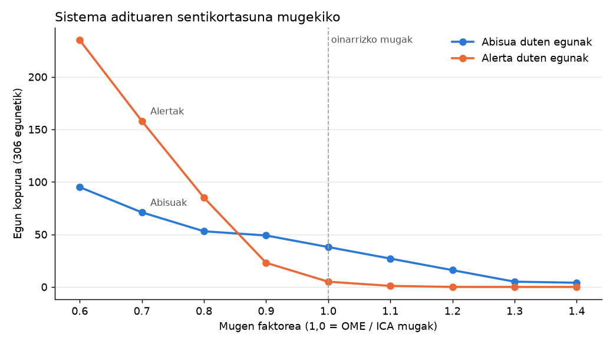

# Sistema adituaren funtzionamenduaren froga

Sortua: 2026-11-09 · Script-a: `probak_sistema_aditua.py`

## 1. Proba-kasuak

| Kasua | Espero ziren arauak | Lortutako alertak | Exekutatutako arauak (ordena) | PM10 eraginkorra | Emaitza |
|---|---|---|---|---|---|
| Egun normala | - | - | R0 | 10.0 | Ondo |
| PM10 neurgailurik ez | R1 | R1 | R1 | 12.0 | Ondo |
| PM10 hutsik + estimazio altua (kateatzea R1 -> R2) | R1, R2 | R1, R2 | R1 → R2 | 50.0 | Ondo |
| PM10 OME muga gainditzen | R2 | R2 | R0 → R2 | 60.0 | Ondo |
| PM10 "Ona" gainditzen | R3 | R3 | R0 → R3 | 25.0 | Ondo |
| Neurgailu-anomalia | R3, R4 | R3, R4 | R0 → R3 → R4 | 30.0 | Ondo |
| Ozono-episodioa (klusterra 2) | R5 | R5 | R0 → R5 | 10.0 | Ondo |
| O3 altua baina beste kluster bat | - | - | R0 | 10.0 | Ondo |
| O3 OME muga gainditzen | R5, R6 | R5, R6 | R0 → R5 → R6 | 10.0 | Ondo |
| NO2 OME muga gainditzen | R7 | R7 | R0 → R7 | 10.0 | Ondo |

Hirugarren kasuak **aurrerantz kateatzea** erakusten du: R1-ek `pm10_eraginkorra` egitatea sortzen du ereduaren estimazioarekin, eta motorrak arauak berriro ebaluatzean R2 aktibatzen da.

## 2. Mundakako datu errealak (306 egun)

| Araua | Aktibazio kopurua |
|---|---|
| R1 | 49 |
| R3 | 15 |
| R4 | 3 |
| R5 | 34 |
| R6 | 5 |

ALERTA mailako alertaren bat duten egunak: **5**. ABISUA duten egunak: **38**.

Mundaka aire garbiko estazioa da: PM10-ak eta NO2-ak ez dute inoiz OMEren muga gainditzen, eta alerta bakarrak ozonoarenak dira (udan). R1 49 aldiz aktibatzen da, PM10 neurgailuak daturik eman ez duen egunetan.

## 3. Sentikortasun-analisia

Muga guztiak faktore berarekin biderkatu ditugu eta alerta kopurua berriro kalkulatu dugu.

| Faktorea | Alerta duten egunak | Abisua duten egunak |
|---|---|---|
| 0.6 | 235 | 95 |
| 0.7 | 158 | 71 |
| 0.8 | 85 | 53 |
| 0.9 | 23 | 49 |
| 1.0 | 5 | 38 |
| 1.1 | 1 | 27 |
| 1.2 | 0 | 16 |
| 1.3 | 0 | 5 |
| 1.4 | 0 | 4 |

Sistema oso sentikorra da mugekiko, batez ere ozonoarenekiko: O3-aren balio gehienak 60-90 µg/m³ artean daude, mugatik gertu. Mugak %20 jaistean, alerta duten egunak 5 izatetik 85 izatera pasatzen dira (alarma-nekea: herritarrek alertei kasu egiteari uzten diote). Mugak igotzean, alertak desagertu egiten dira eta benetako episodioak gal daitezke. OME/ICA mugak (faktorea 1,0) zientifikoki justifikatuta daude eta oreka ona ematen dute estazio honetarako.

## 4. Arrisku-indize lausoa

| Egoera | PM10 | O3 | NO2 | Indizea (0-100) | Etiketa |
|---|---|---|---|---|---|
| Aire garbia | 8 | 55 | 3 | 15.4 | baxua |
| Udako eguna | 18 | 85 | 3 | 50.0 | ertaina |
| O3 muga inguruan | 20 | 98 | 4 | 66.9 | altua |
| Partikula-episodioa | 48 | 70 | 10 | 68.8 | altua |
| NO2 altua | 12 | 60 | 32 | 84.6 | altua |

Logika lausoak muga zorrotzen arazoa leuntzen du: O3 = 98 eta O3 = 101 egunek alerta desberdina ematen dute arau zorrotzekin, baina antzeko arrisku-indizea lausoarekin.
